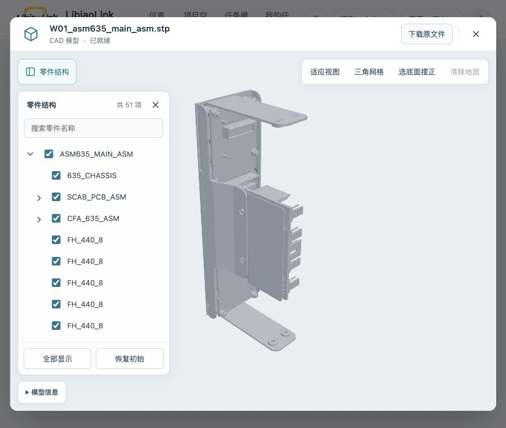

# STEP 已完成产物缓存：本地系统验收

2026-10-21，任务附件和文件库已能复用同一文件版本的完整解析产物。关闭窗口再打开、换入口打开以及重启本地完整系统后，都没有再次启动 STEP 解析。服务保持在 `http://localhost:3000`，使用实际业务 API、独立 PostgreSQL 18、MinIO 与本地 Casdoor 登录。

## 本地实测

公开文件 `W01_asm635_main_asm.stp`，输入 2,720,220 bytes。同一文件、同一版本顺序打开；未替换源文件或使用业务接口替身。

| 打开方式 | 查看器就绪 | W01 累计转换任务 | W01 累计 worker 启动 |
| --- | ---: | ---: | ---: |
| 本轮开始前 | — | 5 | 5 |
| 任务附件：首次建立缓存 | 14.280 秒 | 6 | 6 |
| 任务附件：关闭后再次打开 | 1.167 秒 | 6 | 6 |
| 文件库：同一版本打开 | 0.897 秒 | 6 | 6 |
| 重启本地系统后：文件库再次打开 | 1.228 秒 | 6 | 6 |

时间取外壳 `data-cad-ready-ms`：查看器挂载至模型安装完成并等待两个动画帧，包含当前打开的服务请求、资源读取和显示。本轮开始前的五个任务来自此前联调，不是缓存命中。最后三次命中复用本轮首个完成任务；读取持久化任务库及其 `workerStarted` 事件核对，最终为 6 个任务、6 次 worker 启动、0 个活跃 worker，缓存索引保留 1 份产物。命中响应里的 worker 耗时/RSS 仍指原始转换，不代表本次打开耗时。

四次均显示 **2,335 / 2,335 个逻辑对象、46 / 46 个实例、46 / 46 个物理网格**，零件树 51 项。缓存模型通过树选中、隐藏、仅显示及二次点击取消：隐藏 `635_CHASSIS` 后为 2,156 个逻辑对象、45 个实例；仅显示后为 179 个逻辑对象、1 个实例；取消后恢复全部。画布拾取也正常。



## 实现和定向验证

- 宿主为原引擎 SQLite/CAS 增加完成产物索引。键包含 file/version/content、输入大小/文件名、固定解析器指纹、传输配置、名称编码；两个业务入口无需分别生成结果。
- 命中跳过 S3 原件读取与 STEP worker，沿用引擎对 manifest 和全部二进制 buffer 的 SHA 校验。Partial、失败、损坏和过期结果不得命中。
- actor/view 仍属于授权边界。每次请求重新检查当前文件权限，每个窗口取得自己的短期绑定和资源 lease；释放或取消一个缓存窗口不影响另一个。处理中的任务不共享，保留原取消隔离。
- 产物保留期沿用 24 小时；完成索引跨服务重启持久化。历史无索引产物在功能更新后需首次生成一次。未修改独立 CAD 源码、面身份、缺面政策或网格参数。

**18 项定向检查通过**：Python 生命周期 6 项，实际 native HTTP 集成 12 项。覆盖跨窗口命中、无权限/借用 job ID 拒绝、独立 lease、取消隔离、版本和名称编码失效、真实 buffer 损坏后重算、gateway 重启后复用。HTTP 集成用受控 box 几何与业务夹具；上表另在完整本地业务系统通过浏览器操作验证公开 W01。

```sh
# server/；CAD_PYTHON 指向现有 OCP 环境
PYTHONDONTWRITEBYTECODE=1 "$CAD_PYTHON" test/cad-result-cache.test.py
CAD_TEST_PYTHON="$CAD_PYTHON" node node_modules/vitest/vitest.mjs run --config test/cad.vitest.config.ts test/cad-platform.test.ts
```

未运行全量构建或无关静态检查。设计参照 [OWASP 缓存安全实践](https://cheatsheetseries.owasp.org/cheatsheets/Web_Cache_Security_Cheat_Sheet.html) 中逐请求授权与缓存隔离原则；本项目复用的是通过权限边界暴露的转换产物。

## 范围

性能数字是本机公开 W01 的单次顺序测量，不能推为所有 STEP 的打开时间；首次打开和缓存失效仍需转换，同时尚在处理的窗口不合并任务。该功能在当前本地集成分支完成，公司环境尚未合入或部署。
