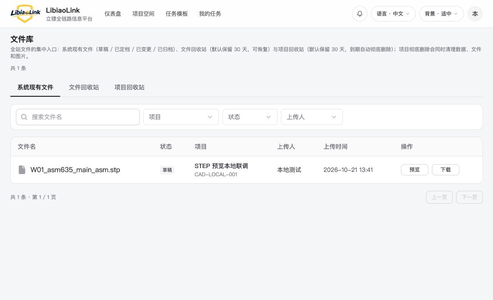
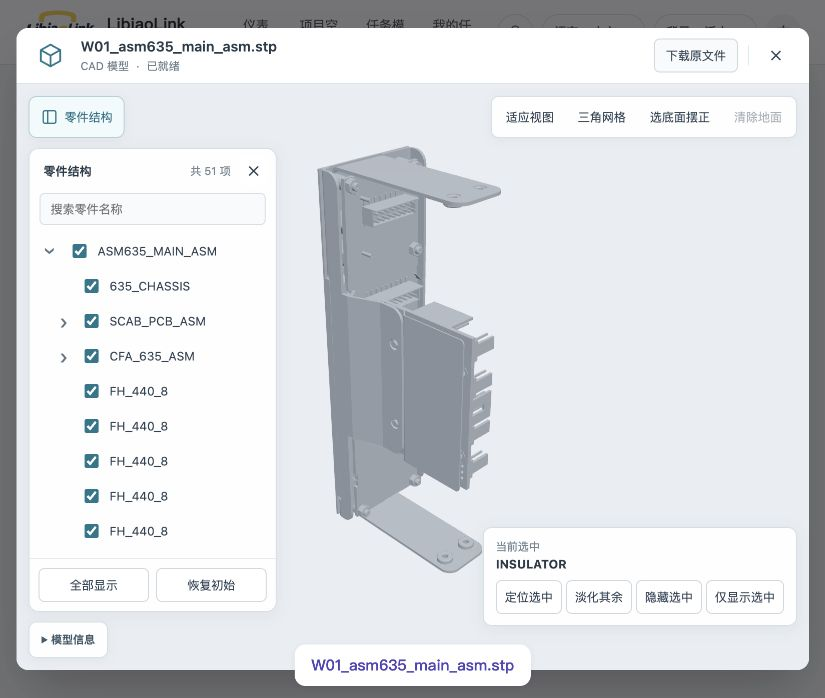

# 本地完整系统：STEP 业务链路

2026-10-21，在当前集成分支运行完整前端与实际 Nest `AppModule`。本地 Casdoor 4.4.0 通过 authorization code + PKCE 完成登录，业务数据写入独立 PostgreSQL 18，文件通过现有分片上传接口进入私有 MinIO。没有注册独立试用夹具的身份/存储替身。入口为 `http://localhost:3000`；不需要先合入 main。

## 已验证

在页面创建 `CAD-LOCAL-001` 测试项目与“布局定档”任务，上传公开语料 W01。任务附件与账号菜单“文件库”读取到同一文件/版本，均打开固定 `f103d1c` ViewerSession，而不是旧浏览器 WASM 查看器。

| 文件 | 任务入口查看器就绪 | 文件库入口查看器就绪 | 零件树 | 完整显示 |
| --- | ---: | ---: | ---: | --- |
| W01_asm635_main_asm.stp | 15.453 秒 | 13.659 秒 | 51 项 | 2,335 / 2,335 个逻辑对象，46 / 46 个实例 |

时间来自外壳 `data-cad-ready-ms`：查看器挂载后开始计时，模型安装并等待两个动画帧后结束。是本机当前运行状态下的一次业务链路结果，没有据此宣称提速或大文件秒开。

同日后续已增加完成产物缓存：W01 首次建立缓存 14.280 秒，任务附件再开 1.167 秒，文件库 0.897 秒，重启后 1.228 秒，后三次没有新增解析 worker。上表保留缓存改造前的历史结果；当前缓存口径与验证见 [缓存联调结果](CACHE_RESULTS.md)。

- 画布直接拾取命中 `INSULATOR`；通过树选中 `635_CHASSIS`。隐藏该实例后显示计数为 2,156 / 2,335、45 / 46；恢复后回到 2,335 / 2,335、46 / 46。
- 定位、淡化、隐藏、仅显示四项逐一开启再取消，`aria-pressed` 均为 false → true → false；仅显示期间为 179 / 2,335、1 / 46，取消恢复全部。
- 查看器“下载原文件”走实际下载服务与 MinIO；落盘文件 SHA-256 与上传原件一致。关闭后返回文件库。
- 重跑准备脚本后，62 个迁移无漂移，保留 1 个项目、1 个任务、1 个文件和 1 个版本；API 角色没有建表权限，不能改写审计记录。
- 日志增加会话 Cookie、Authorization、CSRF、内部令牌及响应 Set-Cookie 遮蔽；使用实际 Pino 配置输入五类测试凭据，输出均不含原值，正常消息保留。

## 运行与验证方式

见 [本地完整系统说明](../../server/cad-engine/README.md#本地完整系统)。`local-source-loader.mjs` 只转译按需加载的业务模块，保留 Nest 注入元数据；实际应用启动和上述浏览器操作是本轮验证。未运行全量构建、无必要的静态测试或重复几何语料回归。仅增加本地启动工具和日志遮蔽，CAD 源码、接收政策和网格参数未变。

所有服务仅绑定 loopback。复用已有 PostgreSQL 18 镜像与两套 CAD Python 环境；官方 Casdoor/MinIO 下载经发布方 SHA-256 核对，解压后删除下载压缩包。凭据、源文件与运行缓存不提交。

## 限制

这次验证使用独立本地账号和测试数据；公司 main 合入、真实公司 SSO/数据库/对象存储和服务器部署仍未完成。Office、外部翻译和通知服务未在本地配置；本轮只验收 STEP 业务链路，不扩大格式或几何支持声明。
